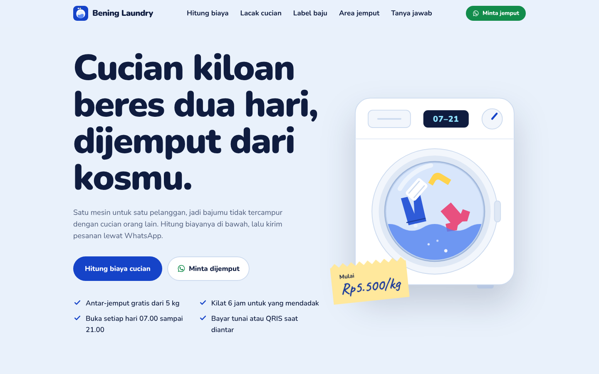
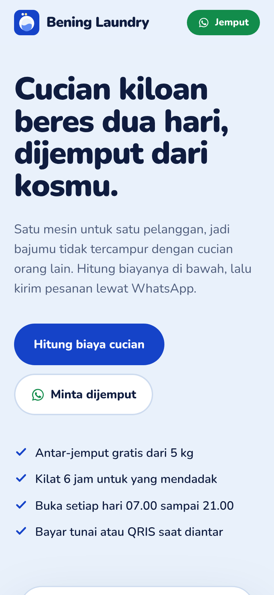

# Bening Laundry

A landing page for **Bening Laundry**, a pay-per-kilo laundry (*laundry kiloan*) with pickup and delivery in Condongcatur, Sleman, Yogyakarta. Visitors estimate the cost of their laundry, request a pickup through WhatsApp, track their order with a code, and check whether their area is covered.

**Live site:** https://bening-laundry.vercel.app

| Desktop | Mobile |
| --- | --- |
|  |  |

> Bening Laundry is a fictional business. This site is a portfolio concept by OmGround. The WhatsApp number and the map are placeholders, so no real orders are sent.

## About the system

The most common questions a laundry gets are how much it will cost, when it will be ready, and whether they can pick it up. This page answers all three before the customer even sends a message:

1. The visitor chooses a service, weight, speed, scent, and pickup slot.
2. A receipt (*nota*) fills in as they go, with the total and the estimated finish time.
3. One button sends the order to the laundry's WhatsApp, and the reply includes a laundry code.
4. The visitor enters that code in the tracker to follow the laundry from pickup to delivery.

Everything runs in the browser. There is no backend, database, or login.

## Features

### Hero
- Front-loading washing machine illustration with clothes tumbling in the drum, moving water, and bubbles.
- The drum spins faster the faster the visitor scrolls.

### Price calculator
- Three services (wash and iron, wash and fold, iron only) with per-kilo prices and turnaround times.
- Weight control with a slider and buttons, with a small drum that fills up as the weight goes up. A minimum charge of 3 kg applies.
- Regular or 6-hour express, four scent options, and pickup or drop-off with address and time slot.
- Pickup is free from 5 kg. Below that, a fee is added automatically.

### Receipt preview
- Yellow carbon-copy receipt with a torn top edge and handwritten numbers, like the *nota* Indonesian laundries hand out.
- Shows each line, the circled total, and an estimated finish time calculated in Western Indonesia Time (WIB) from the current time and opening hours.

### WhatsApp ordering and tracking
- In demo mode, the order opens as a simulated WhatsApp chat with an automatic reply containing a laundry code.
- The tracker accepts that code and moves through six steps (picked up, weighed, washing, drying, ironing and folding, out for delivery) in real time. Any other valid code shows a sample status.
- Invalid codes show a clear error with the expected format.
- In live mode, the button opens WhatsApp with the order message prefilled.

### Care label reader
- Twelve garment care symbols drawn in SVG. Tapping one shows its meaning and how the laundry treats that garment, on a card styled like a stitched clothing label.

### Pickup area map
- Illustrated map with the outlet and a 3 km free-pickup ring. Tapping an area draws the courier route and shows the distance, travel time, and whether pickup is free.

### Also included
- Per-item prices for bed covers, shoes, bags, and helmets, a four-step process section, and an FAQ.

## How it works

| Concern | Approach |
| --- | --- |
| Content | Services, prices, pickup rules, care labels, tracker steps, map places, and FAQ live in `lib/data.ts`. |
| Pricing | `calculator.tsx` derives the total from the selected options on every render, so the receipt is always in sync. |
| Finish time | Calculated in the browser in the Asia/Jakarta time zone, rolling over to the next opening time when the laundry is closed. |
| Tracking | The last code from the chat simulation is shared through `WaProvider`, so the tracker can follow that order live. |
| WhatsApp | `WaProvider` opens the chat simulation when `demo` is `true`, or a `wa.me` link when it is `false`. |
| Motion | Motion (Framer Motion) for the drum, receipt numbers, timeline, and route drawing. Respects the reduced-motion setting. |

## Tech stack

| Area | Tools |
| --- | --- |
| Framework | [Next.js 16](https://nextjs.org) (App Router, statically prerendered) |
| UI | React 19, TypeScript |
| Styling | Tailwind CSS v4 |
| Animation | [Motion](https://motion.dev) and CSS keyframes |
| Fonts | Nunito and Caveat, self-hosted via Fontsource |

## Project structure

```
app/
  layout.tsx            Metadata, fonts, and base page setup
  page.tsx              Page sections
  globals.css           Theme colors, fonts, water and receipt styles
  icon.svg, apple-icon.png, opengraph-image.jpg
components/
  washer.tsx            Washing machine illustration
  calculator.tsx        Price calculator, mini drum, receipt
  tracker.tsx           Laundry status tracker
  care-labels.tsx       Care label symbols and explanations
  area-map.tsx          Map data and colors for this site
  illustrated-map.tsx   Reusable SVG map with route drawing
  wa-sim.tsx            WhatsApp button and chat simulation
  wa.tsx                WhatsApp link helper, icon, rupiah formatter
  demo-note.tsx         Footer note marking the business as fictional
lib/
  data.ts               All page content
docs/                   Screenshots for this README
```

## Getting started

Requires Node.js 20 or later.

```bash
npm install
npm run dev
```

Open http://localhost:3000. For a production build, run `npm run build` and then `npm start`. Run `npm run lint` to check the code.

## Using it for a real business

1. Replace the name, address, services, prices, and FAQ in `lib/data.ts`.
2. Adjust `pricing` for the minimum weight, express surcharge, pickup fee, and free-pickup threshold.
3. Set `whatsapp.number` to the owner's number in international format and set `whatsapp.demo` to `false`.
4. Connect the tracker to a real order system if one exists, or remove the section.
5. Remove `<DemoNote />` from the footer in `app/page.tsx`.

## Deploying

The project deploys to [Vercel](https://vercel.com) with no extra configuration and no environment variables. Every push to `main` triggers a new production deployment.

## Accessibility

- Works with a keyboard, with visible focus outlines and a skip link.
- Form controls have labels, and the tracker announces errors and status changes.
- Animations are reduced when the visitor's system asks for reduced motion.
- Layout tested at phone, tablet, and desktop widths.
